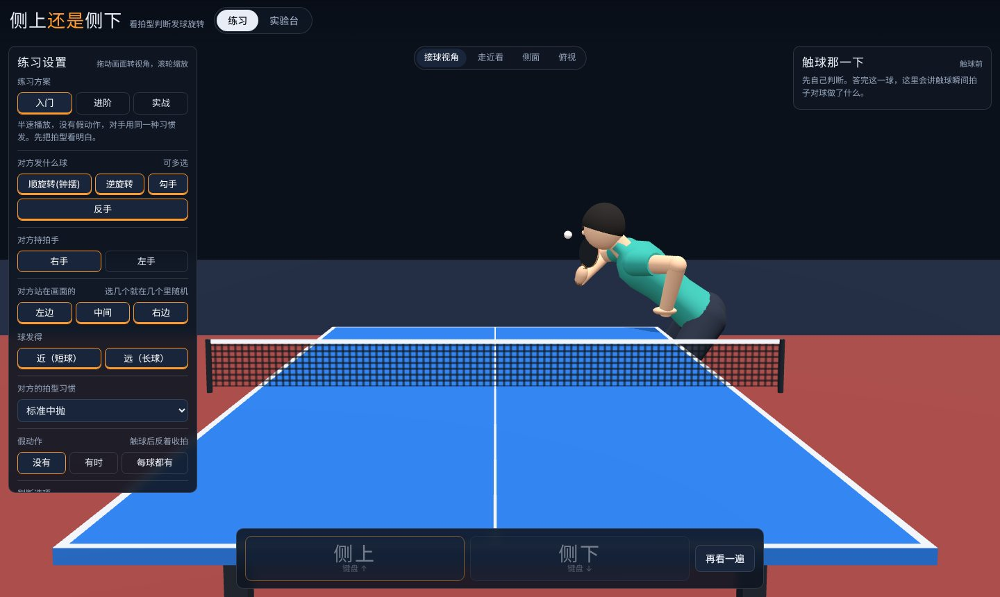
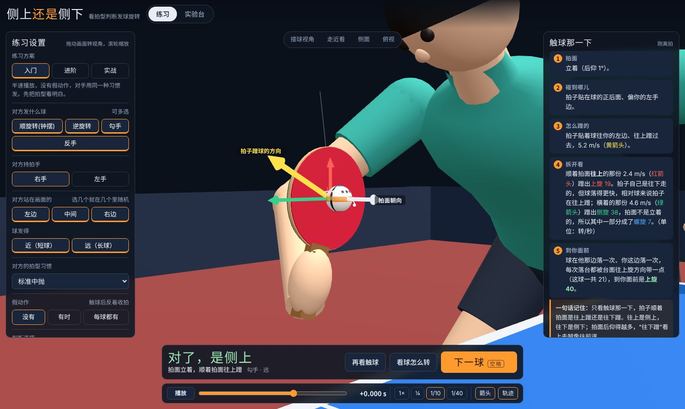
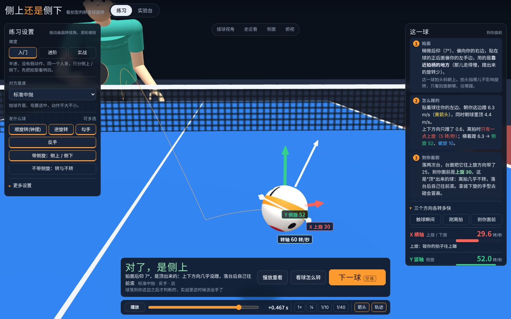
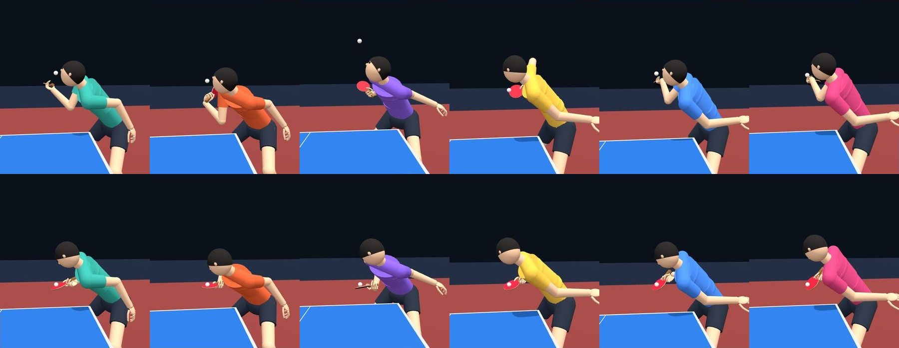
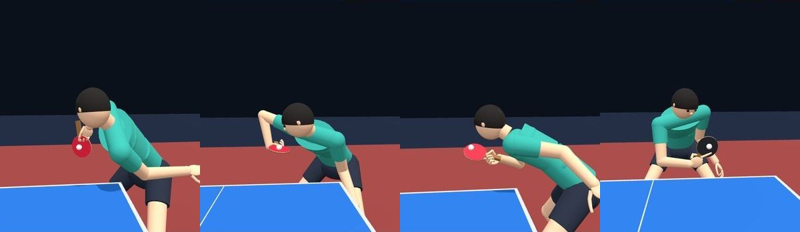
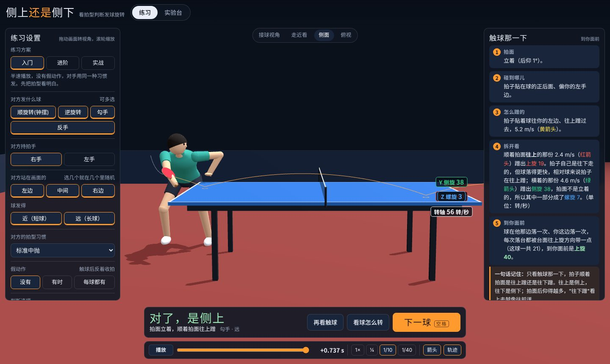

# 侧上还是侧下

练习看对方发球的拍型，判断来球是侧上还是侧下、转还是不转。

**直接打开：<https://jax1ng.github.io/serve-spin-trainer/>**

> 改了代码推到 `main` 后，这个地址一两分钟内会自动更新（GitHub Pages，读的是 `docs/` 文件夹）。
> 也可以把仓库下载下来，直接双击 `docs/index.html`（three.js 放在 `docs/vendor/` 里，不联网也能跑，只有字体会退回系统字体）。

球的旋转不是预设动画。每一个发球都是先定触球瞬间的拍面和拍速，再交给一套碰撞 + 飞行 + 台面反弹的物理引擎去算，落点、过网、到你面前还剩多少上下旋，全部是算出来的结果。发球的人也不是预设动画：他是一副有关节活动范围的骨架，每个球都现算出"怎么站、怎么弯腰、手臂各关节转到多少度，才能在触球那一瞬间正好做到物理要的拍面和拍速"。



## 怎么练

1. 点「发球」（或按空格）。对手托球、抛球、引拍、挥拍，球按真实球路飞过来。
2. 触球之后才能作答：`↑` 上旋（侧上），`↓` 下旋（侧下），开了三选项时 `→` 是不转。
   - 球是素球，没有标记，看不出它在怎么转。
   - **球一落到你这边台面就消失。** 落台之后那段弧线拱不拱太容易看出上下旋，实战里等看清那一段早就该出手了。想更难可以改成"一过网就消失"或"一离拍就消失"。
   - 答完会告诉你是在球飞到哪儿的时候下的判断（过网前 / 过网后落台前 / 落台之后）。
3. 答完自动把整个动作慢放一遍：引拍 → 触球（放得最慢）→ 收拍或假动作 → 球一路飞到你面前，中途不停。触球那一下画面里有：
   - 白箭头：拍面朝向
   - 黄箭头：拍子贴着球蹭的方向
   - 红箭头 / 绿箭头：把黄箭头拆成"顺着拍面上下的那份"和"横着的那份"
4. 右侧「这一球」用三条讲清楚：拍面多仰、碰到球的哪儿、用拍面的哪一段；往哪蹭、各蹭出多少旋转；落台两次后到你面前还剩多少。有假动作时再加一条。
5. 「看球怎么转」把镜头凑到球跟前，球在原地慢慢转，X / Y / Z 三根轴的分量各有箭头，可以只看其中一根。「慢放重看」再放一遍。
6. 空格下一球。



左侧设置（改了之后从下一个球开始生效，不会动眼前这个球）：

| 设置 | 说明 |
| --- | --- |
| 难度 | 入门（半速、同一个人发、无假动作、只分侧上 / 侧下）· 进阶（原速、每球换人、有时假动作、加上转与不转）· 实战（默认每球假动作、球一过网就看不到）。三档只是把下面的选项一次摆好，摆完哪一项都能再改，改了也还在这一档 |
| 假动作 | 没有 / 有时 / 每球都有。就在难度下面，哪一档都能调 |
| 球看到哪儿为止 | 落到你这边 / 过网 / 一离拍。同样哪一档都能调，实战也可以看到落台 |
| 对方是谁 | 六位选手里挑一位，或者每球随机换一位（见下） |
| 发什么球 | 顺旋转(钟摆)、逆旋转、勾手、反手，可多选 |
| 带不带侧旋 | 带侧旋：侧上 / 侧下 / 侧旋不转。不带侧旋：上旋 / 下旋 / 不转，也就是"转与不转" |
| 更多设置 | 对方持拍手、站在画面的左 / 中 / 右、球发得近 / 远、两个还是三个选项、播放速度 |

视角：接球视角、走近看、侧面、俯视。任何时候都可以拖动旋转、滚轮缩放。

「实验台」里没有预设发球：自己拖拍面后仰角、左右偏角、三个方向的拍速、球的下落速度、胶皮摩擦系数，引擎照实算，下网、出界也照实显示。



## 判断的依据

只看触球那一下，拍子**顺着拍面**是往上蹭还是往下蹭：

- 往上蹭 → 上旋（侧上）
- 往下蹭 → 下旋（侧下）。拍面后仰得越多，"往下蹭"看上去越像往前送
- 横着蹭的那一份只出侧旋；拍面不立着时，其中一部分变成螺旋（绕前进方向转）
- 蹭得又薄又快才转。同样的架势，用靠近拍柄的地方去碰（那儿走得慢）、或者顶得多蹭得少，出来的就是不转
- **拍头朝哪儿不算数。** 同一个侧旋，拍头可以朝下（钟摆）、朝上（勾手）、横着（反手），也可以斜着；决定旋转的只有拍面朝哪、贴着球往哪蹭

这里的"蹭"是拍子**相对于球**的运动。球在下落，所以拍子自己往下走、但没有球落得快时，相对球来说仍然是往上蹭，出来的是上旋。

判对错按**到你面前**的上下旋，不是离拍时的。球在对方台面和你这边台面各落一次，每次落台台面摩擦都把球往上旋方向带一点：下旋球和不转球两跳合计被带走 20–40 转/秒（短球落台更陡，带得更多），上旋球本来就接近纯滚动，只多 10–20。所以：

- 离拍时下旋不到二十几转/秒的球，到你面前已经不转了。这就是"不转"：动作是往下蹭的，但蹭得不够
- 到你面前还是下旋的球，离拍时都在三十转/秒上下或更多
- 几乎不摩擦、"顶"出来的球，离拍时不转，落台后自己往前滚，到你面前带一点上旋。拿搓下旋的手型去碰会冒高，所以归在上旋一类

到你面前不足 5 转/秒记"不转"。

## 六位选手

同一种发球，每个人发出来都不一样。这里没有用真人的名字，是六种常见的类型：

| 选手 | 特点 |
| --- | --- |
| 标准中抛 | 抛球齐眉，弯腰适中，动作不大不小 |
| 低蹲手腕型 | 蹲得很低、脸快贴到台面，引拍小，靠手腕一抖；假动作多是飞快地把拍子收回身前 |
| 高抛大摆型 | 球抛过头顶一米多，引拍大，大臂带着甩，转得凶 |
| 站直快节奏 | 站得比较直，抛得低，出手快 |
| 抬肘内扣型 | 肘架得高，手腕往里扣得深，拍头垂得低 |
| 收拍幅度大 | 触球后的动作特别大，开了假动作时尤其明显 |

不一样的地方包括：抛多高、蹲多低、弯腰多深、引拍多大、手腕和大臂各出多少力、抛完球那只手收到哪儿、触球后怎么收拍、会做哪几种假动作（往上一提 / 往下一切 / 飞快收回身前）。同一个人每次发球的节奏和引拍幅度也带一点随机。





## 坐标和三根轴

球台中心为原点，接球的人（你）站在 +Z 端。

- X 横轴：平行球网，你的右手边为正。绕它转是上旋 / 下旋
- Y 竖轴：向上。绕它转是侧旋，俯视逆时针为正，碰你的拍子往你左边蹦
- Z 前后轴：指向你。绕它转是螺旋，落台后往一侧拐

判断上旋 / 下旋看的是 X 轴分量。显示时三根轴跟着球的飞行方向取。

## 物理引擎

`src/physics.js`，不依赖任何库。

- 球：2.7 g，半径 20 mm，薄球壳，转动惯量 I = (2/3)·m·R²
- 碰撞（球拍、台面共用）：法向按恢复系数；切向先按"咬住"算，所需摩擦冲量超过库仑上限 μ·J_n 就改按滑动。球拍只用到触球瞬间的拍面法线和触球点速度
  - 台面：μ = 0.25，e = 0.98 − 0.02·|v_n|
  - 胶皮：e = 0.878 − 0.020·|v_n|，切向恢复 0.819 − 0.010·|v_t|；摩擦上限 μ = 1.0 是我自己取的假设值，实验台里可以改
- 飞行：重力 + 空气阻力 + 马格努斯力，RK4，步长 1 ms。阻力系数和升力系数用 Conti 等 2026（arXiv:2606.28805）给的分段表
- 由碰撞的角动量关系直接得到：ω = (3 / 2R) · Δv × n（n 是拍面法线）。上面"判断的依据"就是这条关系换成眼睛能看到的说法

发球生成（`src/serve.js`）：先模拟抛球得到触球时球的速度；选定旋转轴方位和摩擦薄厚；用牛顿法解出能打到落点、过网余量 1–5 cm 的出手速度；下旋和不转按"两跳之后到你面前"的上下旋来调（带侧旋的调旋转轴方位，不带侧旋的调摩擦薄厚）；由碰撞模型反解球拍速度；最后把"拍面 + 拍速"重新喂给正向碰撞和飞行，所有显示的量都取正向结果。

没有算的东西：球和胶皮的形变细节、飞行中转速的衰减、擦网和擦边。

## 人物和动作

`src/skeleton.js` 是骨架：骨盆 → 腰 → 胸 → 肩 → 上臂 → 肘 → 前臂旋转 → 手腕 → 手 → 球拍，15 个关节变量，每个关节只做人做得到的转动，范围取常见的人体关节活动度。握法有两种：横拍握法（拍子固定在手里），和发球握法（拇指食指捏住拍肩、后三指松开，拍子能在指间转，钟摆发球拍头垂得下来靠的就是这个）。手指是一节一节画的。

`src/motion.js` 算动作，全部在关节角度上做，所以中间每一帧都是人摆得出来的姿势：

1. **触球姿势。** 在关节活动范围内搜索朝向、前倾、转体、肩、肘、手腕；拍面朝向由前臂旋转和屈腕精确满足，站位由"拍面上的触球点必须在球那儿"精确解出。代价 = 别扭程度 + 穿模 + 离这位选手的习惯多远 + 发这个拍速费不费劲。
2. **触球速度。** 把物理要的拍速分摊到手腕、前臂、肘、肩、转体、重心移动上（加权最小范数；手腕型的人手腕分得多）。
3. **整个动作。** 托球准备（略弯腰，拍子收在托球手旁边）→ 球抛起来人跟着直起来、引拍 → 球落下来时压下去、挥拍，远端关节起动得晚（鞭打）→ 触球 → 各关节顺着自己的转向减速（收拍走的是弧线），或者拐去做假动作 → 直起身准备下一板。两只脚不挪地方。
4. **抛球的手。** 手掌摊平托球、往上送、球离手后顺势再送一小段，然后绕着肩膀往身后或胯边收走。

画出来的拍面在触球瞬间的位置、朝向、触球点速度，和物理用的那一组严格相等（测试里逐个核对）。

下面这些情况的发球直接作废重新生成：

- 球拍、握拍手、小臂、肘扎进自己的身体、头或球台；抛球的手和球拍、持拍手打架
- 球在触球之前提前碰到球拍，或者从头、身体、手臂里穿过去
- **从抛起到触球，接球的人看不见球**——被发球人自己的头、身体或手臂挡住。规则不允许遮挡发球，练判断也得看得见触球。为了不挡，站得越靠正手位，身子就越朝球台转开一些

## 目录

```
docs/                 网站（GitHub Pages 指向这里）
  index.html          构建产物
  vendor/             three.js r128、OrbitControls（MIT，许可证见同目录）
src/
  physics.js          碰撞、飞行、台面反弹
  serve.js            发球生成器、选手、判罚
  skeleton.js         骨架、关节活动范围、握法、手指
  motion.js           触球姿势搜索、整套动作、穿模和遮挡检查
  quat.js             四元数小工具
  main.js             三维场景、练习流程、讲解、实验台
  index.template.html 页面和样式
tools/build.mjs       打包
test/                 回归测试
```

## 开发

```bash
npm install
npm run build     # 生成 docs/index.html
npm test          # 物理单元测试 + 发球生成回归 + 600 个随机发球的逐帧体检
```

`node tools/build.mjs --artifact` 另外输出一份 `dist/artifact.html`，three.js 走 CDN，整个页面只有一个文件。

`npm test` 目前的结果：

- 288 种组合（4 类型 × 左右手 × 3 站位 × 长短 × 上旋 / 下旋 / 不转 × 带不带侧旋）基本都能生成（个别组合偶尔在 18 次尝试内出不来，测试容许 3%），平均 80–90 ms 一个
- 触球瞬间画出来的触球点位置和拍面朝向与物理值相差在 1e-15 量级，触球点速度相差 < 0.02 m/s（差分误差）
- 整个动作里关节都在活动范围内，没有某一帧突然跳走；脚不动；从抛起到触球球一直看得见
- 步长 1 ms 与 0.1 ms 对比落点差约 0.01 mm
- 1000 个随机发球用另一套几何逐帧检查：0–1 例轻微穿插（3–4 cm 以内的手擦拍），没有球被挡住的


